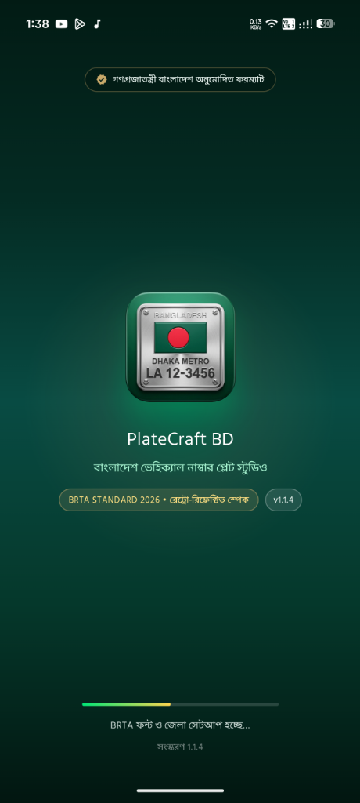
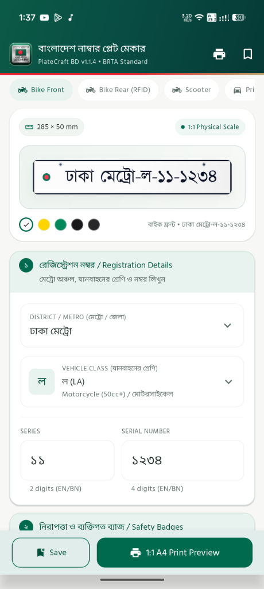
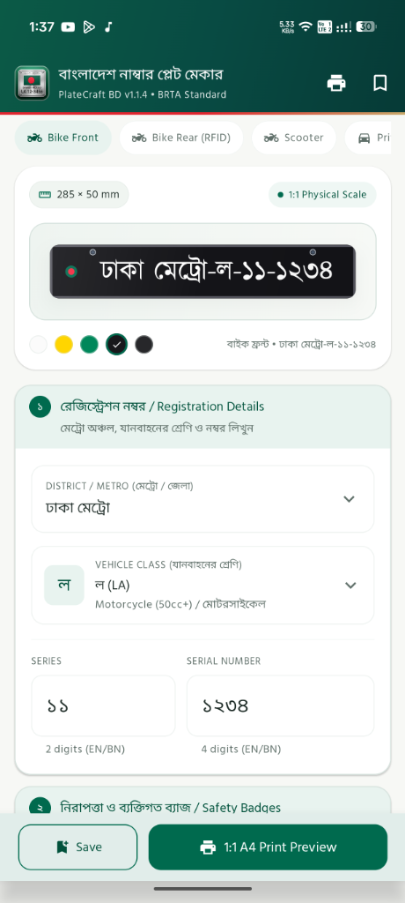
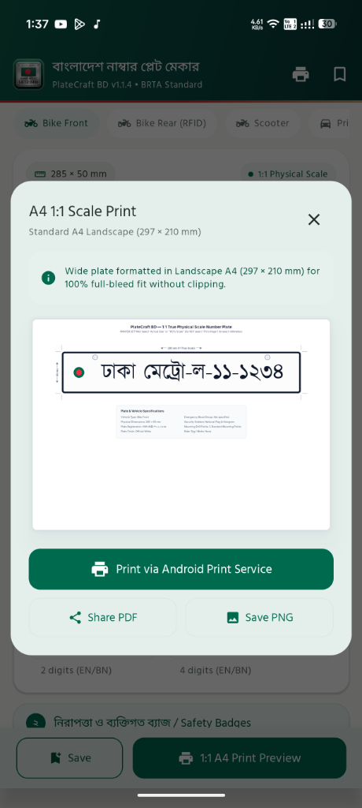
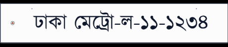

# PlateCraft BD 🇧🇩
### Bangladesh Vehicle Number Plate Designer & 1:1 True-Scale A4 Printing Studio

[](https://github.com/Muhit47/platecraft-bd/releases/latest)
[-blue.svg?logo=android)](https://github.com/Muhit47/platecraft-bd/releases/download/v1.1.4/PlateCraft-BD-v1.1.4.apk)
[-3DDC84.svg?style=flat&logo=android)](https://www.android.com/)
[](https://kotlinlang.org/)
[](https://developer.android.com/jetpack/compose)
[](LICENSE)

**PlateCraft BD** is a modern, high-precision Android application built with **Jetpack Compose** and **Material 3** for designing, previewing, and printing 1:1 physical-scale Bangladesh vehicle number plates strictly following official **Bangladesh Road Transport Authority (BRTA)** specifications.

---

## 📱 App Showcase & Screenshots

<div align="center">
  <table>
    <tr>
      <th align="center">🚀 Brand Splash Screen</th>
      <th align="center">🎨 Studio Editor (Standard)</th>
      <th align="center">🖤 Stealth Dark Theme</th>
      <th align="center">🖨️ 1:1 Scale Print Studio</th>
    </tr>
    <tr>
      <td align="center">
        
      </td>
      <td align="center">
        
      </td>
      <td align="center">
        
      </td>
      <td align="center">
        
      </td>
    </tr>
  </table>
</div>

### 🚘 1:1 Physical Scale Exported Plate Output

<div align="center">
  <p><b>Motorcycle Front Plate (285 × 50 mm / 1:1 Physical Scale Authentic Render)</b></p>
  
</div>

---

## 🌟 What's New in v1.1.4

- ⚡ **Official Clean Package Namespace**: Transitioned to official app package `com.muhit.platecraftbd` eliminating all legacy installation and update conflicts.
- 🛡️ **Stable Android 15 Target**: Upgraded to stable **Target SDK 35** and **Compile SDK 35** ensuring broad compatibility across HyperOS, One UI, OxygenOS, ColorOS, and stock Android.
- 🔐 **Dual-Scheme APK Signing**: Full support for **V1 (JAR Signature)** and **V2 (Full APK Signature)** schemes for seamless side-loading.
- 🔄 **Continuous CI/CD Release Pipeline**: Automated GitHub Actions workflow with embedded persistent keystore validation for reliable release generation.

---

## ✨ Features

- **🇧🇩 100% BRTA Standard Compliant**:
  - Full support for all 64 districts & metro zones (*Dhaka Metro, Chattogram Metro, Sylhet Metro, Rajshahi Metro, Khulna Metro, Barishal Metro, Gazipur Metro, Rangpur Metro, etc.*).
  - Accurate district name formatting (including official BRTA rule: *চাঁপাইনবাবগঞ্জ* automatically formatted as **নওয়াবগঞ্জ**).
  - Complete vehicle class dropdown with Bengali descriptions and engine cc tiers (ক, খ, গ, ঘ, চ, ছ, জ, ঝ, ট, ঠ, ড, ঢ, থ, ল, হ, etc.).
  - Authentic Bengali typography using bundled high-legibility **Hind Siliguri** font.

- **🌟 Custom Automotive Brand Identity & Opening Experience**:
  - Official Deep Emerald (`#042B23`) emblem branding and adaptive launcher icon.
  - Seamless, polished launch splash screen with smooth transition into the studio canvas.

- **📐 1:1 True-Scale Physical Printing Engine**:
  - **Bike Front Plate**: 285 mm × 45 mm (Standard single-line front bar)
  - **Bike Rear Plate**: 200 mm × 100 mm (Standard stacked 2-line plate)
  - **Car Front & Rear Plates**: 520 mm × 110 mm & 300 mm × 200 mm
  - **CNG Auto-Rickshaw**: 240 mm × 140 mm
  - Generates 300 DPI print-ready layouts with cutting border guides and mounting hole markings.
  - Direct system print spooler support (`PrintDocumentAdapter`) and high-resolution PDF export.

- **🎨 Studio & Canvas Visualizer**:
  - Retro-reflective white and green (electric/commercial) plates.
  - 3D embossed border beveling and tactile metallic shading.
  - BRTA security hologram sticker and official circular seal simulation.

- **💾 Saved Designs & History**:
  - Device-local persistence using **Room Database**.
  - Edit, duplicate, re-print, or export past vehicle plate designs at any time.

---

## 🛠️ Architecture & Tech Stack

- **Language**: [Kotlin](https://kotlinlang.org/)
- **UI Framework**: [Jetpack Compose](https://developer.android.com/jetpack/compose) with Material Design 3 (M3)
- **Architecture**: MVVM (Model-View-ViewModel) + Clean Architecture
- **Local Database**: [Room Database](https://developer.android.com/training/data-storage/room) (SQLite + KSP)
- **Concurrency**: Kotlin Coroutines & `StateFlow`
- **Testing**: Local JVM Unit & Robolectric Component Tests

---

## 🚀 Getting Started

### Prerequisites
- **Android Studio Ladybug (2024.2.1)** or newer
- **JDK 17** or newer
- **Android SDK Platform 35** (Target SDK: 35, Min SDK: 24)

### Clone & Build
```bash
# Clone the repository
git clone https://github.com/Muhit47/platecraft-bd.git

# Navigate to project folder
cd platecraft-bd

# Build debug APK
./gradlew assembleDebug

# Run unit and Robolectric tests
./gradlew testDebugUnitTest
```

---

## 📂 Project Structure

```
├── app/
│   ├── src/
│   │   ├── main/
│   │   │   ├── java/com/example/
│   │   │   │   ├── data/           # Room Database, DAO, and Entities
│   │   │   │   ├── model/          # BRTA Districts, Vehicle Classes, Plate Specs
│   │   │   │   ├── print/          # 1:1 True-Scale Print Engine & PDF Generator
│   │   │   │   ├── ui/             # Jetpack Compose Screens, ViewModels, Theme
│   │   │   │   └── MainActivity.kt # Main entry point with Edge-to-Edge support
│   │   │   ├── res/
│   │   │   │   ├── font/           # Bundled Bengali Font (Hind Siliguri)
│   │   │   │   ├── mipmap/         # Adaptive launcher icons
│   │   │   │   └── values/         # Strings, colors, and themes
│   │   │   └── AndroidManifest.xml
│   │   └── test/                   # Robolectric and JUnit unit tests
│   └── build.gradle.kts
├── gradle/
│   └── libs.versions.toml          # Gradle Version Catalog
├── settings.gradle.kts
└── README.md
```

---

## 📄 License

This project is licensed under the MIT License - see the [LICENSE](LICENSE) file for details.
